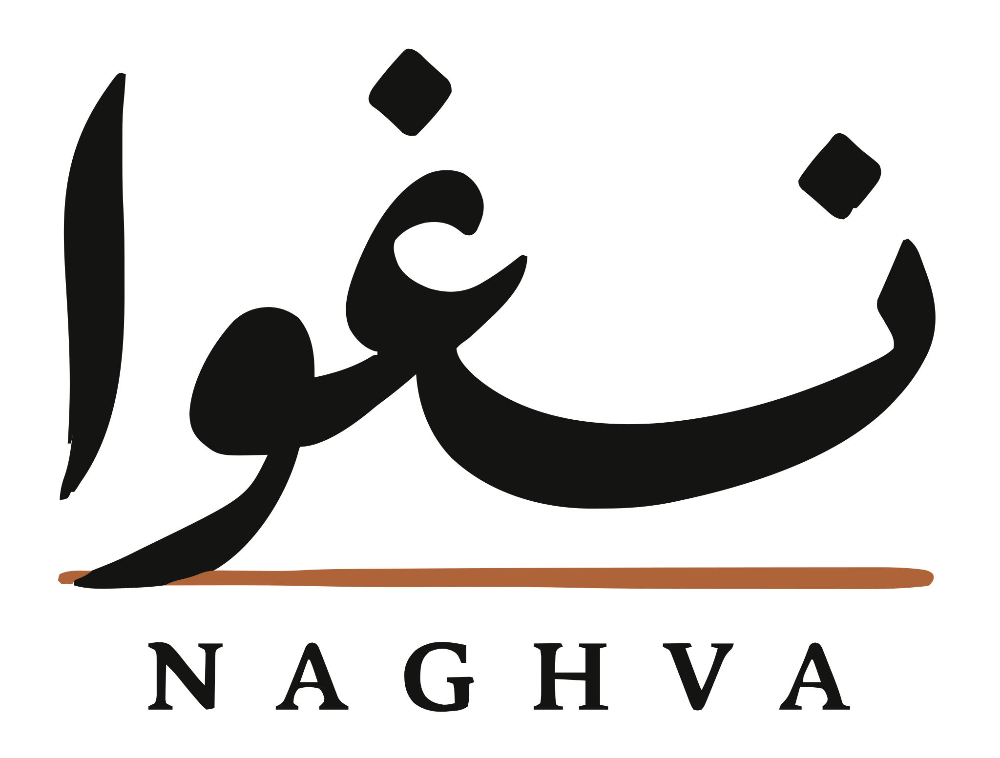

  <picture>
    <source media="(prefers-color-scheme: dark)" srcset="assets/brand/logos/wordmark-with-rule/naghva-wordmark-with-rule-on-dark-transparent.svg">
    
  </picture>

# Naghva · نغوا

Naghva is an archive of independent Iranian music: who made what, with whom,
when and how, every fact backed by a quoted source, equally in Persian and
English. You can read it at [naghva.com](https://naghva.com/?utm_source=github&utm_medium=referral&utm_content=readme). This repository
is everything behind the site, open for anyone to read, reuse and build on.

The [vision](specs/vision.md) says what Naghva is for, and
[definitions](specs/definitions.md) what counts as independent and as
Iranian.

## Status

Naghva is a small project kept by one person. It grows an artist at a time,
and is kept online and open so the work stays reachable whatever happens
next. The record is not complete and doesn't claim to be.

## What you'll find

- **The record:** artists, their releases, the people they worked with, their
  concerts and the moments of their lives, each fact tied to a source and the
  passage it rests on.
- **Articles:** each artist's life and work, written from those sources, in
  Persian and English.
- **The specs:** what Naghva covers, which sources count, and how it is
  written.
- **The website** that turns all of this into naghva.com.

## Licences

- The record is [CC0 1.0](https://creativecommons.org/publicdomain/zero/1.0/):
  no rights reserved.
- Articles are [CC BY 4.0](https://creativecommons.org/licenses/by/4.0/).
  Credit "Naghva (naghva.com)", with a link where you can.
- The code is MIT.
- Logos and the miniature art are all rights reserved.
- Quoted passages belong to their authors and publishers, and images to
  whoever made them. They are covered by none of the above.

## Corrections and takedowns

If something is wrong or missing, open an issue with the page and, if you
have one, a source. Anything about a person comes down when that person asks,
and an image when the person who made it asks: open an issue, or write to
[contact@naghva.com](mailto:contact@naghva.com) if you'd rather not do it in public.
